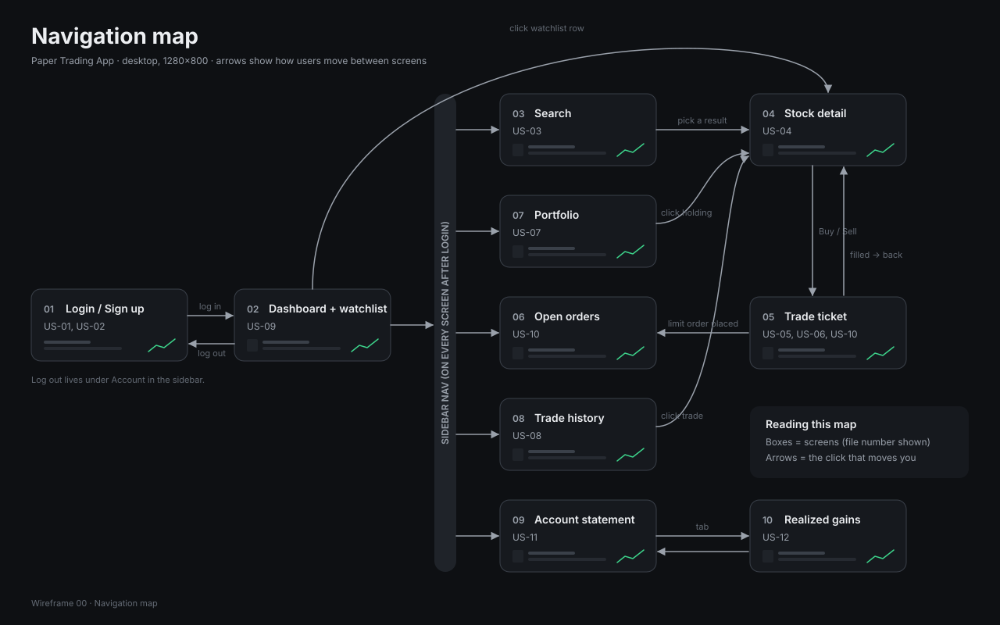

# Team Project: Stock Trading Simulator

[](https://github.com/EfrenMedina/team-project/actions/workflows/ci.yml)

## Summary

A desktop app for practising stock trading with simulated money. Users sign up, search real stocks, view prices and charts, buy and sell shares, place limit orders, and track their portfolio and profit/loss. Every movement of cash is recorded in a double-entry ledger, so balances can always be explained and audited.

Built in Java 17 with Swing (FlatLaf), SQLite and Maven, following Clean Architecture.

## Features and who built them

| User story | Feature | Owner | Status |
|---|---|---|---|
| US-01 | Sign up | Efren Medina Arias | To do |
| US-02 | Log in and log out | Efren Medina Arias | To do |
| US-03 | Search stocks | Lifeable | To do |
| US-04 | Stock details and chart | Andrei Mazin | To do |
| US-05 | Buy shares, with no double-buys | Efren Medina Arias | To do |
| US-06 | Sell shares | Abdulhadi Alnowailaty | To do |
| US-07 | Portfolio and profit/loss | Abdulhadi Alnowailaty | To do |
| US-08 | Trade history | Abdulhadi Alnowailaty | To do |
| US-09 | Watchlist | Lifeable | To do |
| US-10 | Limit orders (place, list, cancel, automatic fills) | Andrei Mazin, Abdulhadi Alnowailaty | To do |
| US-11 | Account statement | Andrei Mazin | To do |
| US-12 | Realized gains report | Efren Medina Arias | To do |
| US-13 | Stop-loss orders (stretch) | Efren Medina Arias | To do |
| US-14 | Performance chart (stretch) | Abdulhadi Alnowailaty | To do |

Planning and tickets live in the team's Jira board (project `SCRUM`).

## APIs used

| API | Used for |
|---|---|
| [Finnhub](https://finnhub.io/docs/api) | Live quotes, symbol search, company profile |
| [Twelve Data](https://twelvedata.com/docs) | Daily price history for charts, and fallback quotes |

### Provider decision (SCRUM-18)

Tested on 2026-10-29 with free-plan keys, using [`spike/MarketDataSpike.java`](spike/MarketDataSpike.java).
Every endpoint we need returned data for AAPL and MSFT. One real response per endpoint is saved in
[`src/test/resources/api/`](src/test/resources/api/).

| Endpoint | Provider | Result |
|---|---|---|
| Quote (`/quote`) | Finnhub | Works |
| Symbol search (`/search`) | Finnhub | Works |
| Company profile (`/stock/profile2`) | Finnhub | Works |
| Daily candles (`/stock/candle`) | Finnhub | **HTTP 403**, not on the free plan |
| Daily time series (`/time_series`) | Twelve Data | Works |
| Quote (`/quote`) | Twelve Data | Works (used as the fallback) |

**Measured rate limits** (`java spike/MarketDataSpike.java limits`):

- **Finnhub: 60 requests per minute.** 60 back-to-back quote calls succeeded in 5.2 s, and the 61st
  got HTTP 429 `Too many requests`. The `X-Ratelimit-Limit` and `X-Ratelimit-Remaining` response
  headers show the budget, so the gateway can read them.
- **Twelve Data: 8 credits per minute and 800 per day.** Each call costs 1 credit, including
  `/api_usage`. The 9th credit in a minute got HTTP 429 `run out of API credits for the current minute`.

**Decision.** Finnhub serves quotes, symbol search and company profiles. Twelve Data serves daily
price history only, because Finnhub's candles need a paid plan. Twelve Data's 8 calls a minute is the
tight limit, so we cache each symbol's daily history and fetch it at most once a day. The 60
Finnhub calls a minute are shared by everything that polls quotes (watchlist, portfolio, limit
order fills), so polling must batch symbols and stay well under that budget.

**Fallback.**

- If Finnhub fails or returns 429, quotes come from **Twelve Data `/quote`**, which works on the
  free plan.
- If Twelve Data is out of credits, charts show the **last cached history**.
- If both providers are down, offline demo mode (SCRUM-43) serves the recorded JSON in
  `src/test/resources/api/`.

API keys are read from `config.properties` in the project root (git-ignored, never committed).

## How to run

Requirements: JDK 17 and Maven 3.9+.

```bash
# Build and run all tests
mvn clean verify
```

1. Create `config.properties` in the project root with your API keys:
   ```properties
   finnhub.api.key=YOUR_KEY
   twelvedata.api.key=YOUR_KEY
   ```
2. Run the app: _main class and command to be added with the app shell (SCRUM-23)._

Offline demo mode: _to be added (SCRUM-43)._

## How we work

- Every change goes through a pull request into `main`, with one approval and a passing build.
- Branch names start with the Jira key, e.g. `SCRUM-19-ledger-entities`, so they link to the ticket.
- Money is stored as integer cents; never use `double` or `REAL` for money. Every movement of cash is a
  journal entry; [`docs/ledger.md`](docs/ledger.md) explains debits, credits and the ledger classes.

## How we test

- Run everything with `mvn clean verify`. This runs the JUnit 5 tests, writes the coverage report to `target/site/jacoco/index.html` and the style report to `target/checkstyle-result.xml`. CI uploads both on every PR.
- Copy the pattern in [`ExampleInteractorTest`](src/test/java/app/ExampleInteractorTest.java) when testing a use case:
  - an **in-memory DAO** instead of SQLite, so tests are fast and need no files;
  - a **fake presenter** that records what the interactor sent, so we assert on output data, not on the UI;
  - a **fixed `Clock`** passed into the interactor, so time-based logic gives the same result every run.
- Model actions as types (records and enums, e.g. `Side.BUY`, `OrderType.LIMIT`), never as strings that need parsing.
- Name tests after behaviour: `action_condition_expectedResult`, e.g. `placeOrder_zeroQuantity_presentsErrorAndSavesNothing`.
- Test both the success path and each failure path of every interactor.
- Tests must not call the real stock APIs; use the fake gateway and the recorded JSON in `src/test/resources/api/`.

## Wireframes

Every screen is sketched in [`docs/wireframes/`](docs/wireframes/), with a table of screens, user stories and owners. Start with the navigation map:



## Screenshots

_Coming once the first screens are built._
